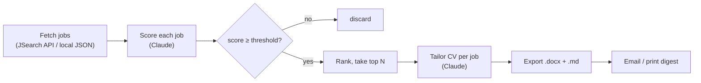

# Job Agent

An AI-powered job-hunting agent that fetches live job postings, scores each one against your profile, and rewrites your CV to target the best matches — then emails you a daily digest.

Built in Python around the Claude API. It turns a repetitive daily task (search boards → read listings → tweak the CV for each) into one command.


---

## How it works



1. **Fetch** — pull live postings from the JSearch API (Google for Jobs: LinkedIn, Indeed, kariera.gr, skywalker.gr…), or read a local JSON file for offline testing.
2. **Score** — Claude rates every posting 0–100 against your profile and returns a keep/skip verdict with a one-line reason.
3. **Filter & rank** — keep everything above a score threshold, take the top N.
4. **Tailor** — for each kept job, Claude rewrites your master CV to target that specific role, using only facts already in the CV (no fabrication).
5. **Deliver** — each tailored CV is written as `.docx` and `.md`, and a digest of the top matches is emailed (or printed to the console).

> **Note on design:** this is intentionally a linear pipeline rather than a full tool-calling agent. The pieces (scoring, tailoring) are deterministic and easy to reason about first; an agentic tool-calling loop is on the roadmap.

## Features

- Live job search covering the Greek market via a single official API (no scraping)
- LLM-based relevance scoring with transparent reasons
- Per-job CV tailoring, grounded strictly in your real experience
- Clean Word (`.docx`) export with no system dependencies
- Optional email digest over SMTP
- Offline mode for developing and testing without spending API quota
- Configurable search queries, location, recency window, and score threshold

## Project structure

```
job-agent/
├── agent.py           # orchestrator — run this
├── config.py          # settings, profile, thresholds, search queries
├── sources.py         # job sources: JSearch API + local-file fallback
├── llm.py             # Claude calls: score_job, tailor_cv
├── export.py          # markdown CV -> .docx
├── notify.py          # email digest (SMTP)
├── master_cv.md       # your master CV (source of truth for tailoring)
├── jobs_sample.json   # sample jobs for offline testing
├── debug_jsearch.py   # one-off API response inspector
├── requirements.txt
└── .env.example       # copy to .env and fill in
```

## Tech stack

- **Python 3.10+**
- **Anthropic Claude API** (`claude-sonnet-5`) — scoring and CV tailoring
- **JSearch API** (via RapidAPI) — real-time job listings from Google for Jobs
- **python-docx** — Word export
- **requests**, **python-dotenv**, **smtplib**

## Setup

```bash
git clone https://github.com/dimliaro/job-agent.git
cd job-agent
python -m venv .venv && source .venv/bin/activate   # Windows: .venv\Scripts\activate
pip install -r requirements.txt
cp .env.example .env
```

Fill in `.env`:

| Variable | Required | What it is |
|---|---|---|
| `ANTHROPIC_API_KEY` | yes | Anthropic API key |
| `RAPIDAPI_KEY` | for live search | RapidAPI key, subscribed to the JSearch API (free Basic plan) |
| `EMAIL_USER` / `EMAIL_PASS` / `EMAIL_TO` | optional | Gmail sender / App Password / recipient for the digest |

Then edit `master_cv.md` with your real experience, and adjust `PROFILE` and `SEARCH_QUERIES` in `config.py`.

## Usage

```bash
python agent.py
```

Tailored CVs land in `output/` and the digest is emailed (or printed if email isn't configured).

**Test without spending API quota** — set `SOURCE = "file"` in `config.py` to run the full pipeline against `jobs_sample.json`.

## Configuration

Everything lives in `config.py`:

- `SOURCE` — `"jsearch"` (live) or `"file"` (offline)
- `SEARCH_QUERIES` — list of role searches (one API call each)
- `SEARCH_COUNTRY` / `SEARCH_DATE_POSTED` — market and recency window
- `MIN_SCORE` / `TOP_N` — filtering thresholds
- `PROFILE` — the description each job is scored against
- `MODEL` — the Claude model to use

## Example run

```
Loaded 57 jobs (source: jsearch).
   96  Data Engineer (Entry Level) @ DataFlow
   92  Junior Data Analyst @ Acme Analytics
   15  Marketing Manager @ SomeCorp
    2  Senior Frontend Engineer @ Pixel Corp
...
Top matches written to output/ and digest sent.
```

## Cost

Scoring is effectively free (tiny JSON output); the cost is dominated by CV tailoring at roughly **0.7 cent per tailored CV**. A few dollars of API credit covers hundreds of runs. Verify current model rates on the Anthropic pricing page.

## Roadmap

- [x] Live job source (JSearch)
- [x] `.docx` CV export
- [ ] Scheduling (cron / GitHub Actions) for automatic daily runs
- [ ] Batch scoring to cut cost and latency
- [ ] Additional sources (company career-page RSS feeds)
- [ ] True tool-calling agent loop

## A note on data sources

This project uses **official APIs only**. It does not scrape LinkedIn, Instagram, or any site whose terms prohibit automated access. JSearch is a licensed aggregator of Google for Jobs data.

## License

MIT — see `LICENSE`. (Add a `LICENSE` file if you publish the repo.)
